# [SCOPE: WORKSPACE_PROJECT | DDD_TDD_SDD_ARCHITECTURE]
# 專案架構最高核心憲法 (Project Architecture & Agent Governance Kernel)

本綱領為本專案在 Antigravity IDE 內運行 AI 代理協同開發、需求訪談、架構推導、代碼實現、品質門禁與維運治理的最高不可逾越底線。本設定作用於本專案（Workspace-Scoped），不依賴全域設定，確保專案獨立性與版本受控。

---

## 1. 系統不可逾越之核心架構不變量 (Architecture Invariants)

1. **[INVARIANT-1: NO_PREMATURE_DOCS] 討論未完禁止落盤任何文檔律 (Hard Gate)**
   - **嚴禁未對齊提前落盤**：在使用者與 AI 代理人尚未在對話中徹底完成意圖對齊、架構推導、範疇切刀與技術選型前，**嚴禁在磁碟中新增、覆寫或生成任何規格文件或專案代碼**（包括但不限於 `docs/` 下的所有文檔）。
   - **雙階段嚴格推進**：
     1. **第一階段（對話論證）**：所有訪談、架構藍圖、資料結構草案僅在對話中呈現與深入推敲。
     2. **第二階段（用戶授權落盤）**：只有在獲得使用者明確回覆同意（如「確認無誤」、「可以落盤」）後，方可由對應 Subagent 執行檔案寫入。

2. **[INVARIANT-2: PLAN_FIRST_BEFORE_CODE] 無核准實施計畫嚴禁編寫代碼律 (Hard Gate)**
   - **無計畫嚴禁寫碼**：未經使用者審查與核准原子實施計畫前，**嚴禁編寫任何業務代碼與測試代碼**。
   - **原子計畫標準規格**：實施計畫必須由系統架構師（`sa`）產出於 `docs/03-tasks/<module-name>/`，包含明確的 WBS 原子分解、Checkbox `[ ]`、預期修改檔案清單與測試驗證手法。
   - **用戶審批放行**：只有在使用者審查並回覆「批准計畫」後，方可建立 Feature 分支，交由 `qa` 與 `pg` 啟動 TDD 循環。

3. **[INVARIANT-3: AI_AUTO_CLASSIFICATION] AI 主動需求三態辨識律**
   - 任何需求輸入時，AI（由 `pm` 代理人）必須主動進行語意特徵研判與代碼庫現況探勘，主動判定並回報為以下三類之一（附帶信心度與理由），嚴禁由使用者盲目猜測：
     - **【新專案 / 新模組 MVP】**：開拓性功能，必須執行**極致技術棧訪談**（前後端框架版本、DB/Cache 引擎、Docker 基礎鏡像、QPS 與 NFRs）與 **In-Scope vs Out-of-Scope 切刀**。
     - **【線上問題 / Bug 故障】**：異常問題，必須追查現象 vs 預期、TraceId 日誌堆疊、影響半徑、短期止血與反回歸測試。
     - **【技術債 / 架構重構】**：結構治理，必須確認既有黃金驗收測試、防腐層保護、雙寫/絞殺者遷移策略與一鍵回退機制。
   - 若偵測到混雜需求（例如：修 Bug 同時要求新功能），AI 強制提出「切刀拆分建議」。

4. **[INVARIANT-4: SUBAGENT_AUTONOMY_AND_TOOL_ISOLATION] Subagent 物理工具隔離與自主調度律**
   - **自主調度總指揮 (Parent Orchestrator)**：主 Agent 擔任生命週期狀態機調度中心，根據 SDLC 各階段主動派遣宣告 `subagent: true` 的專用 Subagent 獨立作戰，完成後自主交接下一棒，徹底減輕主 Agent 上下文負擔。
   - **工具物理隔離 (Scoped Tools)**：各 Subagent 必須於 Frontmatter 嚴格限制 `tools` 清單：
     - `pm`：僅具備訪談與需求規格編寫工具（`ask_question`, `view_file`, `write_to_file`）。
     - `sa`：僅具備架構推導與設計清單工具（`view_file`, `write_to_file`）。
     - `qa`：僅限測試代碼與 Docker 測試執行（`view_file`, `write_to_file`, `run_command`），**物理禁止修改業務代碼**。
     - `pg`：業務代碼與 Docker 構建（`view_file`, `write_to_file`, `replace_file_content`, `multi_replace_file_content`, `run_command`），**物理禁止修改測試代碼**。
     - `code-reviewer`：**唯審查權**，僅配置唯讀與報告輸出工具（`view_file`, `grep_search`, `write_to_file`），**物理級沒收代碼修改工具**。
     - `ops`：容器映像檔安全、雙探針與維運手冊工具（`view_file`, `write_to_file`, `run_command`）。

5. **[INVARIANT-5: DDD_DEPENDENCY_INVERSION] 領域層純粹與依賴倒置原則 (DIP)**
   - **Domain Layer 保持零污染**：領域實體（Entities）、值對象（Value Objects）、領域事件（Domain Events）絕對禁止依賴任何外部基礎設施（ORM 註解、DB 驅動、HTTP 框架、第三方 SDK）。
   - **依賴倒置（DIP）**：儲存庫（Repository）與外部介面定義在 Domain/Application 層，其實作統一放置於 Infrastructure 層。

6. **[INVARIANT-6: SEPARATION_QA_PG] QA 與 PG 職責物理分離與紅燈先行律**
   - **堅決杜絕球員兼裁判**：測試代碼與業務實作代碼嚴格由兩個獨立角色執行：
     - **`qa` (測試工程師)**：專職根據 SDD 規格編寫 BDD/Gherkin 與極端邊界測試，並確認測試在無實作時 **100% 變紅（Red Phase）**。QA 嚴禁編寫業務實作代碼。
     - **`pg` (研發工程師)**：專職根據原子任務在 Docker 容器內編寫業務代碼，驅使測試轉綠（Green Phase），隨後執行依賴倒置重構（Refactor）。
   - 未通過紅燈驗證前，PG 絕對不得開始寫實作代碼。

7. **[INVARIANT-7: DOCKER_ISOLATED_ENVIRONMENT] 強制 Docker 隔離環境與物理終止律 (Hard Requirement)**
   - **宿主環境零污染與物理隔離**：專案之一切套件安裝（npm, pip, go mod, cargo 等）、建置（build）、測試（test）、伺服器啟動（dev server）**必須 100% 在 Docker 容器中執行**。
   - **非 Docker 環境物理終止原則（Hard Stop）**：任何 Agent 嚴禁直接在主機宿主環境（Windows / PowerShell / Host Terminal）調用編譯器、運行時或直接執行專案測試與代碼。若檢測到當前未處於 Docker 容器環境或 Docker 容器尚未啟動，**Agent 必須立即停止執行（STOP）並提示用戶**，絕不允許冒然在 Host 主機直接運行！

8. **[INVARIANT-8: SENIOR_REVIEW_GATE] 高階代碼審查工程師唯審查權門禁律 (Review-Only Gate)**
   - **唯審查權與零修改權（Strict Review-Only）**：`code-reviewer` 擁有專案最高審查與否決門禁權限，但**絕對禁止直接新增、編輯或修改任何業務代碼與測試代碼**。
   - **一票否決權（Veto Power）**：未通過資深審查員簽核（`APPROVED`），任何實作代碼嚴禁合併或推進至生產部署。
   - **審查報告落盤存證**：每次審查必須出具 `docs/05-reviews/<module-name>/review-YYYYMMDD-<name>.md`，針對 6 大維度（DDD 純粹性、Docker 隔離、測試真實度、代碼壞味道、OWASP 安全、維運可觀測性）進行具體檔案行號評價。

9. **[INVARIANT-9: PRODUCTION_OPS_OBSERVABILITY] 維運可觀測性、探針與零停機回滾律**
   - **三位一體可觀測性**：必須具備結構化 JSON 日誌（帶 TraceId）、Prometheus 度量指標與鏈路追蹤。
   - **健康檢查雙探針**：必須提供 `/health/liveness` 與 `/health/readiness` 探針。
   - **向前相容遷移與零停機回滾**：資料庫遷移禁止破壞性直接刪欄位（遵循 Expand-Contract 模式）。生產環境發布前，`ops` 必須出具 5 分鐘內一鍵版本容器鏡像回滾與降級熔斷 Runbook。

---

## 2. 端到端自主生命週期：活動圖 (Activity Diagram)

```mermaid
flowchart TD
    Start([1. 用戶提出目標願景]) --> Orch[主調度 Agent (Parent Orchestrator)]
    
    Orch -->|自主派遣| PM[Subagent: pm<br/>三態辨識 + 深度訪談]
    PM --> Gate1{門禁一：討論對齊<br/>用戶是否確認方案?}
    Gate1 -->|需調整| PM
    Gate1 -->|用戶確認放行| ReleaseDoc[解除文檔鎖<br/>落盤 docs/01-requirements/<module>/]

    ReleaseDoc --> Orch_SA[主調度派遣]
    Orch_SA --> SA[Subagent: sa<br/>DDD 領域建模 + SDD 規格書]
    SA --> PlanGen[制定原子實施計畫<br/>docs/03-tasks/<module>/]

    PlanGen --> Gate2{門禁二：計畫審批<br/>用戶是否核准計畫?}
    Gate2 -->|退回修改| SA
    Gate2 -->|用戶批准放行| ReleaseCode[解除寫碼鎖<br/>建立 Feature 分支]

    ReleaseCode --> Orch_QA[主調度自主派遣]
    Orch_QA --> QA[Subagent: qa<br/>Docker 內撰寫測試 驗證 100% 紅燈]
    QA --> QADoc[落盤 docs/04-testing-qa/<module>/]

    QADoc --> Orch_PG[主調度自主派遣]
    Orch_PG --> PG[Subagent: pg<br/>Docker 內寫代碼 驅使測試變綠 + 重構]
    PG --> PGCommit[Git Commit 提交變更]

    PGCommit --> Orch_Rev[主調度自主派遣]
    Orch_Rev --> Reviewer[Subagent: code-reviewer<br/>唯讀工具 6 大維度審查]
    Reviewer --> RevDoc[落盤 docs/05-reviews/<module>/]
    RevDoc --> RevCheck{審查裁決?}
    RevCheck -->|REQUEST_CHANGES| PG
    RevCheck -->|APPROVED| Orch_Ops[主調度自主派遣]

    Orch_Ops --> Ops[Subagent: ops<br/>映像檔安全構建 + 雙探針驗證]
    Ops --> OpsDoc[落盤 5 分鐘回滾手冊<br/>docs/06-ops/<module>/]
    OpsDoc --> GitRelease[Git 合併 main 並標記 Release Tag]
    GitRelease --> Done([交付發布完成 匯報用戶])
```

---

## 3. 端到端數據流圖 (Data Flow Diagram - DFD)

```mermaid
flowchart LR
    subgraph S1 [對話記憶層 Context]
        UserReq[(用戶需求與回饋)]
        AlignPlan[(對齊之架構共識與核准計畫)]
    end

    subgraph S2 [持久化檔案庫 docs/ & src/]
        direction TB
        R_Doc[docs/01-requirements/<module>/REQ.md]
        S_Doc[docs/02-architecture-sdd/<module>/SDD.md]
        T_Doc[docs/03-tasks/<module>/TASK.md]
        Q_Doc[docs/04-testing-qa/<module>/QA.md]
        Rev_Doc[docs/05-reviews/<module>/REV.md]
        O_Doc[docs/06-ops/<module>/OPS.md]
        Code_Test[tests/<module>/ 測試代碼]
        Code_Src[src/<module>/ 業務實作]
    end

    subgraph S3 [版本控制 Git]
        Branch_Feat[feat/<module> 分支]
        Tag_Release[vX.Y.Z 標記與 Changelog]
    end

    UserReq -->|1. 訪談對齊| AlignPlan
    AlignPlan -->|2. 用戶核准後落盤| R_Doc
    R_Doc -->|3. 架構推導| S_Doc
    S_Doc -->|4. 分解任務| T_Doc
    T_Doc -->|5. 用戶批准後開分支| Branch_Feat

    Branch_Feat -->|6. QA 編寫紅燈測試| Code_Test
    Code_Test -->|7. 記錄測試結果| Q_Doc

    Q_Doc -->|8. PG 驅使綠燈與重構| Code_Src
    Code_Src -->|9. 唯讀比對審查| Rev_Doc

    Rev_Doc -->|10. 通過核准| O_Doc
    O_Doc -->|11. 發布合流與打 Tag| Tag_Release
```



---

## 4. 專案六大專用 Subagent 矩陣 (Dedicated Subagents)

| Subagent 名稱 | `subagent` | 分配工具權限 (`tools`) | 核心自主職責 | 物理安全邊界 |
| :--- | :---: | :--- | :--- | :--- |
| **`pm`** | `true` | `ask_question`, `view_file`, `write_to_file` | AI 三態辨識、商業範疇切割、驗收條件確立 | 禁碰代碼編譯/測試運行工具 |
| **`sa`** | `true` | `view_file`, `write_to_file` | DDD 領域架構、API 契約、原子實施計畫 | 禁碰代碼實作/終端執行工具 |
| **`qa`** | `true` | `view_file`, `write_to_file`, `run_command` | Docker 內編寫 BDD 測試，嚴格驗證 100% 紅燈 | 僅限操作 `tests/` 與測試命令，禁碰業務代碼 |
| **`pg`** | `true` | `view_file`, `write_to_file`, `replace_file_content`, `multi_replace_file_content`, `run_command` | Docker 內撰寫業務代碼，驅使測試轉綠並重構 | 僅限操作 `src/` 與構建命令，物理禁止修改測試 |
| **`code-reviewer`** | `true` | `view_file`, `grep_search`, `write_to_file` | 六大維度唯讀審查、出具一票否決報告 | **物理級沒收改碼工具**，完全無法動業務或測試代碼 |
| **`ops`** | `true` | `view_file`, `write_to_file`, `run_command` | 容器安全、雙探針驗證、5分鐘回滾手冊、Git Tag | 專注於 Dockerfile, compose, ops 手冊與 Release |

---

## 5. 按模組與生命週期劃分之資產目錄拓撲

所有工程資產嚴格依照 **【業務模組 (Bounded Context)】** 與 **【生命週期階段】** 歸檔於 `docs/` 下：

```text
docs/
├── 01-requirements/<module-name>/     # 需求規格書 (REQ-*.md)
├── 02-architecture-sdd/<module-name>/ # 系統設計規格書 (SDD-*.md)
├── 03-tasks/<module-name>/            # 原子實施計畫 (TASK-*.md，帶原子 [ ] Checkbox)
├── 04-testing-qa/<module-name>/       # 紅燈測試報告 (QA-*.md)
├── 05-reviews/<module-name>/          # 唯審查代碼審查單 (REV-*.md)
└── 06-ops/<module-name>/              # 維運與 5 分鐘回滾手冊 (OPS-*.md)
```

