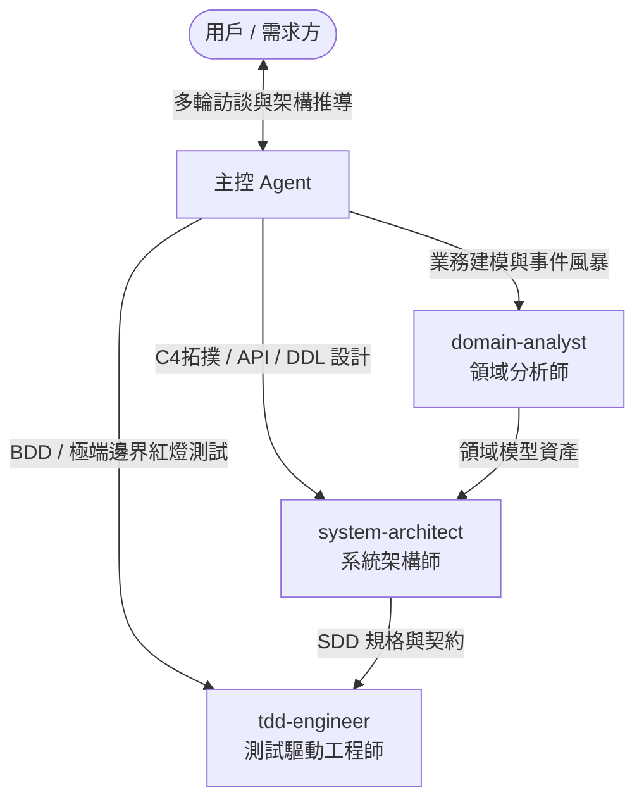

# [SCOPE: WORKSPACE_PROJECT | DDD_TDD_SDD_ARCHITECTURE]
# 專案架構最高核心憲法 (Project Architecture & Agent Governance Kernel)

本綱領為本專案在 Antigravity IDE 內運行 AI 協同開發、架構訪談與代碼生成的最高不可逾越底線。本設定完全作用於本專案（Workspace-Scoped），不依賴全域設定，確保專案獨立性與版本受控。

---

## 1. 系統不可逾越之核心架構不變量 (Architecture Invariants)

1. **[INVARIANT-1: DDD_DEPENDENCY_INVERSION] 領域層純粹與依賴倒置原則**
   - **Domain Layer 保持零污染**：領域實體（Entities）、值對象（Value Objects）、領域事件（Domain Events）絕對禁止依賴任何外部基礎設施（ORM、DB 驅動、HTTP 框架、第三方 SDK）。
   - **依賴倒置（DIP）**：儲存庫（Repository）與外部介面定義在 Domain/Application 層，其實作統一放置於 Infrastructure 層。

2. **[INVARIANT-2: SDD_SPEC_FIRST] 規格先行律（禁止無規格貿然編程）**
   - 任何重大模組或系統功能開發前，必須先透過「系統需求訪談」產出標準的軟體設計規格書（SDD, Software Design Document），對齊限界上下文、API 契約、DDL 與流程時序圖。
   - 規格未經確認前，物理嚴禁逕自編寫業務代碼。

3. **[INVARIANT-3: TDD_TEST_FIRST] 測試先行與紅綠重構律 (Red-Green-Refactor)**
   - 在編寫具體業務實作代碼前，強制由 `tdd-engineer` 先行編寫捕捉領域不變量與邊界條件的失敗測試（Red Phase）。
   - 確認測試能如期變紅（Red）後，方可進入最小實作使其通過（Green），最後進行架構重構（Refactor）。

4. **[INVARIANT-4: AGGREGATE_BOUNDARY_PROTECTION] 聚合根邊界與防腐層 (ACL)**
   - **聚合根是唯一變更入口**：外部禁止直接修改聚合內部的子實體，必須透過聚合根的方法以保證業務不變量（Business Invariants）。
   - **防腐層 (Anticorruption Layer)**：介接任何外部服務、舊系統或第三方 API 時，強制建立 ACL 轉接適配器，杜絕外部髒資料穿透至內部核心域。

---

## 2. 專案專用 Subagent 協同矩陣 (Dedicated Subagents)

本專案配置三位專用 Subagent，協同關係如下：

* **`domain-analyst`**：專用 DDD 業務分析師。專精於業務願景探索、事件風暴（Event Storming）、統一語言（Ubiquitous Language）提煉與限界上下文劃分。
* **`system-architect`**：專用首席架構師。專精於 C4 拓撲架構、API 契約（REST/gRPC）、資料庫 ER/DDL Schema、分散式事務與 NFRs 設計。
* **`tdd-engineer`**：專用測試工程師。專精於將 SDD 規格轉化為 BDD/Gherkin 與極端邊界的單元/整合測試套件。

---

## 3. IDE 流程與雙 Skill 協同架構

* **Agents (Subagents)**：位於 `.agents/agents/`，包含 `domain-analyst.md`、`system-architect.md`、`tdd-engineer.md`。
* **Workflows (斜線工作流)**：位於 `.agents/workflows/`：
  - `/workflow-system-analysis-interview`：啟動顧問級需求與 DDD 架構訪談。
  - `/workflow-spec-driven-development`：啟動規格驅動開發全生命週期（Proposal ➔ SDD ➔ Tasks ➔ TDD）。
* **Skills (雙 Skill 職責分離體系)**：位於 `.agents/skills/`：
  - `system-analysis-architect`：負責需求深層訪談、DDD 建模與架構決策（分析腦）。
  - `spec-driven-lifecycle`：負責規範檔案流轉、模板實例化、任務 Checkbox 勾選與斷點無縫接關（工程手）。
* **Rules**：位於 `.agents/rules/`，於對話中自動常駐載入（`always_on`）。
* **Hooks**：位於 `.agents/hooks.json`，生命週期守門防護。

---

## 4. 專案規格資產目錄 (Single Source of Truth)

所有工程意圖落盤於專案根目錄之 `docs/` 下，與代碼版本庫同步演進：
* `docs/proposals/`：業務需求提案（鎖定商業痛點與 MVP 範圍）。
* `docs/sdd/`：軟體設計規格書（鎖定領域模型、API 契約與 DDL）。
* `docs/tasks/`：原子任務清單（帶 `[ ]` Checkbox，作為 Agent 斷點續做之唯一依據）。

