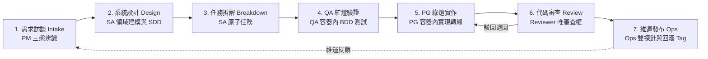

# 規格驅動開發生命週期管理 Skill (Spec-Driven Lifecycle Manager)

本 Skill 專門用於調度與規範 AI Agent 團隊依循六大角色矩陣（PM, SA, QA, PG, Code-Reviewer, Ops）推進研發工作。它確立了「規格為唯一真實源」的執行準則，將所有意圖落盤為文件，杜絕聊天記錄丟失與盲目編程，並涵蓋品質門禁與維運回滾。

---

## 1. 核心規格檔案架構 (File Convention)

所有規格產出物嚴格按照生命週期階段分類放置於專案根目錄的 `docs/` 下：

```text
docs/
├── 01-requirements/       # 需求規格 (由 PM 產出: mvp/, issues/, debts/)
├── 02-architecture-sdd/   # 軟體設計規格書 (由 SA 產出)
├── 03-tasks/              # 原子實施任務清單 (由 SA 產出，帶 [ ] Checkbox)
├── 04-testing-qa/         # 品質與紅燈測試報告 (由 QA 產出)
├── 05-reviews/            # 代碼審查報告 (由 Code-Reviewer 唯審查產出)
└── 06-ops/                # 維運手冊、5 分鐘回滾 Runbook 與 Release Tag (由 Ops 產出)
```

---

## 2. 標準端到端作業循環 (The End-to-End Lifecycle)



### 階段一：需求訪談與三態辨識 (Intake Phase)
1. **指派角色**：調度 `pm`。
2. **AI 主動研判**：自動區分【新專案 MVP】、【線上 Bug】或【技術債重構】。
3. **訪談落盤**：MVP 必須問清前後端/DB/Docker 技術棧；落盤至 `docs/01-requirements/{mvp,issues,debts}/`。

### 階段二：軟體架構設計 (Design Phase)
1. **指派角色**：調度 `sa`。
2. **DDD 建模與規格**：劃分聚合根、防腐層、Docker 拓撲、API 契約與 3NF DDL。
3. **規格落盤**：輸出至 `docs/02-architecture-sdd/SDD-YYYYMMDD-<name>.md`。

### 階段三：原子任務拆解 (Task Breakdown Phase)
1. **指派角色**：由 `sa` 主導拆解。
2. **Checkbox 清單**：拆解為具備 `[ ]` Checkbox 的原子任務。
3. **任務落盤**：輸出至 `docs/03-tasks/TASKS-YYYYMMDD-<name>.md`。

### 階段四：測試先行與實現循環 (TDD Cycle Phase - Docker 容器內)
1. **指派角色**：`qa` 與 `pg` 職責嚴格分離。
2. **Docker 物理終止律 (Hard Stop)**：若 Docker 未啟動，立即停止執行（STOP）並提示用戶，嚴禁在宿主機運行。
3. **QA 紅燈驗證 (Red)**：`qa` 容器內編寫測試並驗證 100% 變紅，落盤至 `docs/04-testing-qa/`。
4. **PG 綠燈實現 (Green & Refactor)**：`pg` 容器內編寫領域代碼至全綠，執行重構並勾選 `[x]`。

### 階段五：高階代碼審查門禁 (Code Review Phase)
1. **指派角色**：調度 `code-reviewer`（**唯審查權，嚴禁編輯任何代碼**）。
2. **6 大維度審核**：針對 DDD 純粹性、Docker 規範、測試邊界、代碼壞味道、資安與可觀測性審查。
3. **審查落盤**：輸出至 `docs/05-reviews/review-YYYYMMDD-<name>.md`。

### 階段六：發布與維運手冊定案 (Ops & Release Phase)
1. **指派角色**：調度 `ops`。
2. **驗證與回滾**：健康雙探針檢查、資料庫向前相容遷移檢核、制定 5 分鐘一鍵回滾 Runbook。
3. **維運落盤**：輸出至 `docs/06-ops/RUNBOOK-*.md` 與 `docs/06-ops/RELEASE-*.md`，標記 Git Tag。

---

## 3. 六大角色協同矩陣

* **`pm`**：AI 主動三態辨識、商業範疇切割、MVP 極致技術棧盤點與驗收條件。
* **`sa`**：系統架構、DDD 建模、防腐層、Docker 拓撲、API/DDL 與原子任務拆解。
* **`qa`**：測試工程師。專職 BDD 測試案例、極端邊界測試與 Docker 容器內紅燈驗證。
* **`pg`**：研發工程師。專職在 Docker 容器內實現領域邏輯轉綠與依賴倒置重構。
* **`code-reviewer`**：高階代碼審查門禁，擁有**唯審查權與一票否決權**，絕不修改代碼。
* **`ops`**：維運工程師。專職 Docker 映像檔安全、雙探針、5 分鐘回滾 Runbook 與版本控制發布。
