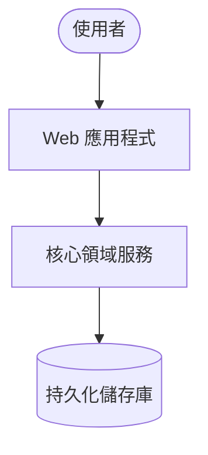

# 軟體設計規格書 (Software Design Document - SDD): [系統/模組名稱]

## 1. 規格元數據 (Metadata)
- **規格編號**：SDD-YYYYMMDD-[簡稱]
- **關聯提案**：[docs/proposals/proposal-YYYYMMDD-*.md]
- **主架構師**：system-architect
- **版本狀態**：[ v1.0-Draft | v1.0-Approved | Under-Implementation | Archived ]

---

## 2. 系統拓撲與限界上下文 (System Context & Bounded Contexts)
### 2.1 C4 Context / Container 視圖


### 2.2 領域不變量與防腐層 (Invariants & ACL)
- **領域層純粹約束**：嚴禁 Domain Layer 引入任何基礎設施依賴。
- **外部整合防腐**：介接外部服務時強制設立 ACL 轉接適配器。

---

## 3. DDD 領域模型詳細設計 (Domain Model Design)
### 3.1 聚合根與實體 (Aggregates & Entities)
- **聚合根**：`[實體名稱]`
  - 核心屬性：`Id`, `狀態`, `建立時間`
  - 領域方法：`MethodA()`, `MethodB()`
- **值對象 (Value Objects)**：`[值對象名稱]`

### 3.2 領域事件 (Domain Events)
| 事件名稱 | 觸發時機 | 攜帶負載 (Payload) | 發布策略 |
| :--- | :--- | :--- | :--- |
| `[EntityCreatedEvent]` | 建立實體並通過驗證後 | `{ id, timestamp }` | In-Memory / MQ |

---

## 4. API 契約與傳輸模型 (API Contracts & DTOs)
### 端點一：`[POST /api/v1/resource]`
- **功能描述**：
- **請求 Payload Schema**：
```json
{
  "name": "string",
  "email": "string"
}
```
- **回應 Schema (200 OK / 201 Created)**：
```json
{
  "code": 200,
  "message": "success",
  "data": { "id": "uuid" }
}
```
- **錯誤代碼矩陣**：400 Bad Request, 404 Not Found, 409 Conflict

---

## 5. 資料持久化與儲存結構 (Database Schema & DDL)
```sql
-- DDL Migration Schema
CREATE TABLE IF NOT EXISTS sample_table (
    id VARCHAR(36) PRIMARY KEY,
    name VARCHAR(100) NOT NULL,
    created_at TIMESTAMP DEFAULT CURRENT_TIMESTAMP
);
CREATE INDEX idx_sample_created_at ON sample_table (created_at);
```

---

## 6. 非功能性需求與安全性約束 (NFRs & Security)
- **併發控制**：樂觀鎖定 / 分散式鎖策略。
- **資料保護**：敏感欄位 AES-256 加密存儲。
- **性能目標**：P99 延遲小於 200ms。
