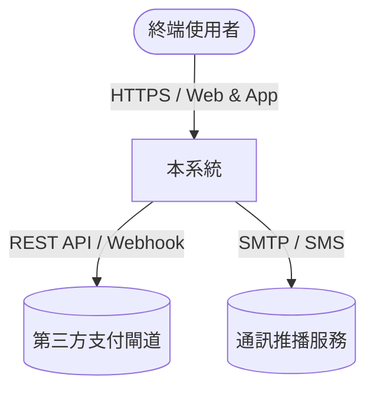
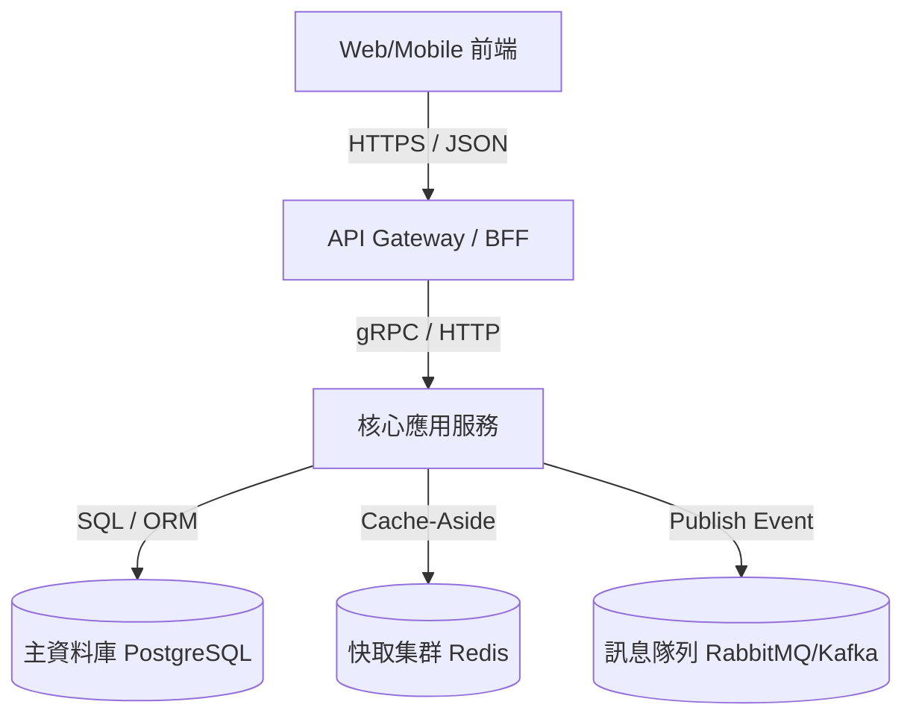
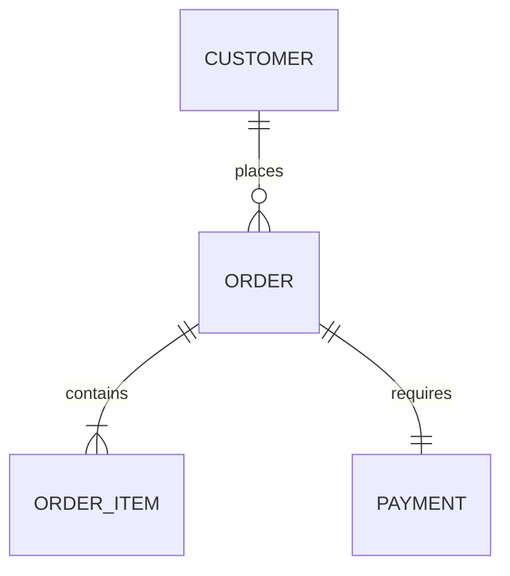
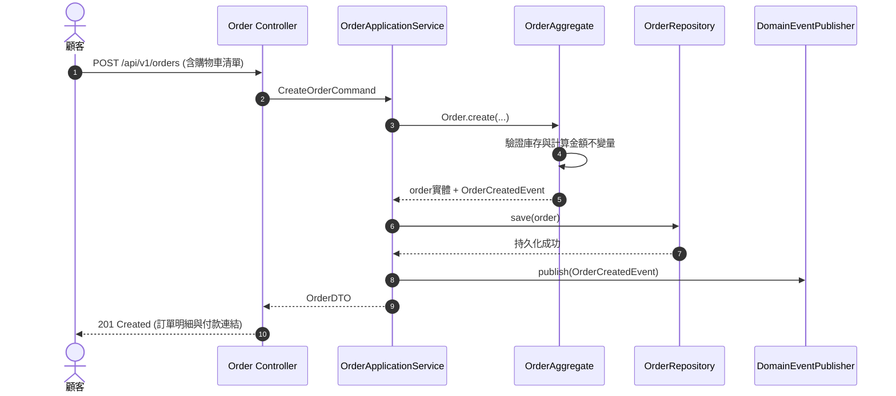

# 軟體設計規格書 (Software Design Document - SDD) 標準範本

> **文件版本**：v1.0.0  
> **系統名稱**：[系統/服務名稱]  
> **負責架構師**：[Lead Architect]  
> **狀態**：[Draft / Under Review / Approved]  
> **最後更新日期**：YYYY-MM-DD  

---

## 1. 系統概述與願景 (System Overview & Vision)
### 1.1 業務背景與問題陳述
* [描述現有痛點與構建本系統的業務動機]

### 1.2 系統目標與衡量指標 (Success Metrics)
* [North Star Metric 及關鍵業務指標 KPI/SLA]

### 1.3 系統範疇 (Scope)
* **包含 (In Scope)**：
* **不包含 (Out of Scope)**：

---

## 2. DDD 領域架構與模型設計 (Domain Architecture)
### 2.1 統一語言詞彙表 (Ubiquitous Language)
| 領域名詞 (Domain Term) | 中文定義 | 英文代號 | 歸屬上下文 | 說明與約束 |
| :--- | :--- | :--- | :--- | :--- |
| `Order` | 購買訂單 | `Order` | 履約上下文 | 代表一筆不可變的購買協議 |
| `Money` | 幣值金額 | `Money` | 共享內核 | 包含 amount 與 currency 的值對象 |

### 2.2 限界上下文映射 (Context Map)
* [描述核心域、支撐域、通用域之關係與 ACL 防腐層位置]

### 2.3 聚合根與實體模型 (Aggregates & Entities)
* **聚合根 A (Aggregate Root)**: `Order`
  * 實體 (Entities): `OrderItem`
  * 值對象 (Value Objects): `Money`, `ShippingAddress`, `OrderStatus`
  * 不變量規則 (Invariants): `總金額必須等於所有子項目小計扣除折扣之總和`

---

## 3. 系統架構拓撲 (System Architecture & C4 Model)
### 3.1 系統上下文圖 (C4 - System Context)


### 3.2 容器與分層拓撲 (C4 - Container Level)


---

## 4. API 規格契約 (API Contract Specification)
### 4.1 端點總覽
| Method | Endpoint | 描述 | 認證方式 | 冪等性 |
| :--- | :--- | :--- | :--- | :--- |
| `POST` | `/api/v1/orders` | 建立新訂單 | Bearer JWT | 是 (Idempotency-Key) |
| `GET` | `/api/v1/orders/{id}` | 查詢訂單詳情 | Bearer JWT | 是 |

### 4.2 核心端點詳細定義範例
* **`POST /api/v1/orders`**
  * **Headers**: `Idempotency-Key: <UUID>`
  * **Request Body Schema**:
    ```json
    {
      "items": [
        { "sku": "SKU-1002", "quantity": 2 }
      ],
      "shipping_address": {
        "recipient": "王小明",
        "phone": "+886912345678",
        "detail": "台北市信義區信義路五段7號"
      }
    }
    ```
  * **Response 201 Created**:
    ```json
    {
      "order_id": "ord_9f83a2c",
      "status": "PENDING_PAYMENT",
      "total_amount": { "amount": 1200, "currency": "TWD" },
      "created_at": "2026-10-20T12:00:00Z"
    }
    ```
  * **錯誤碼規範 (Error Codes)**: `400 INVALID_PAYLOAD`, `409 INVENTORY_INSUFFICIENT`

---

## 5. 資料持久化與 Schema 設計 (Data Model & Schema)
### 5.1 實體關係圖 (ER Diagram)


### 5.2 核心資料表 DDL 定義 (PostgreSQL 範例)
```sql
CREATE TABLE orders (
    id VARCHAR(36) PRIMARY KEY,
    customer_id VARCHAR(36) NOT NULL,
    status VARCHAR(32) NOT NULL,
    total_amount NUMERIC(12, 2) NOT NULL,
    currency VARCHAR(3) NOT NULL DEFAULT 'TWD',
    idempotency_key VARCHAR(64) UNIQUE,
    created_at TIMESTAMP WITH TIME ZONE DEFAULT CURRENT_TIMESTAMP,
    updated_at TIMESTAMP WITH TIME ZONE DEFAULT CURRENT_TIMESTAMP
);

CREATE INDEX idx_orders_customer_id ON orders(customer_id);
CREATE INDEX idx_orders_created_at ON orders(created_at);
```

---

## 6. 核心業務流程序列圖 (Sequence Diagrams)


---

## 7. TDD 測試驅動規範與紅燈測試矩陣 (TDD Strategy)
### 7.1 測試金字塔分層比例
* 單元測試 (Unit Tests) 70%：聚焦於 Aggregate Root 與純業務邏輯。
* 整合測試 (Integration Tests) 20%：驗證 Repository、API Endpoint 與 DB/Redis 整合。
* 端對端測試 (E2E Tests) 10%：核心走通關鍵流程。

### 7.2 核心單元測試先行案例 (Red Phase Spec)
```typescript
describe('OrderAggregate Root - Business Invariants', () => {
  it('應在購物車項目為空時拒絕建立訂單 (Throw EmptyOrderException)', () => {
    expect(() => Order.create({ items: [] })).toThrow(EmptyOrderException);
  });

  it('應在總金額計算時正確扣減滿額優惠券', () => {
    const order = Order.create({
      items: [{ price: 500, quantity: 2 }],
      coupon: new FixedDiscountCoupon({ minSpend: 800, discount: 100 })
    });
    expect(order.totalAmount.amount).toBe(900);
  });
});
```

---

## 8. 非功能性需求與運行維護 (NFRs & Operational Architecture)
1. **併發與分散式控制**：採用樂觀鎖（Optimistic Locking，版本號 `version`）防範超賣。
2. **高可用與容錯**：外接服務全面配置 Circuit Breaker（斷路器）與重試指數退避（Exponential Backoff）。
3. **安全性與審計**：所有寫入操作均需記錄完整操作者、IP、變更前後 Payload 至 `audit_logs`。
4. **可觀測性**：整合 OpenTelemetry 分散式鏈路追蹤（TraceId 貫穿前端、API、DB 查詢）。
